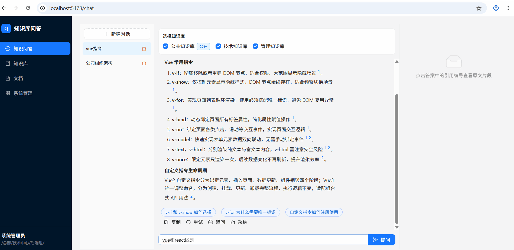
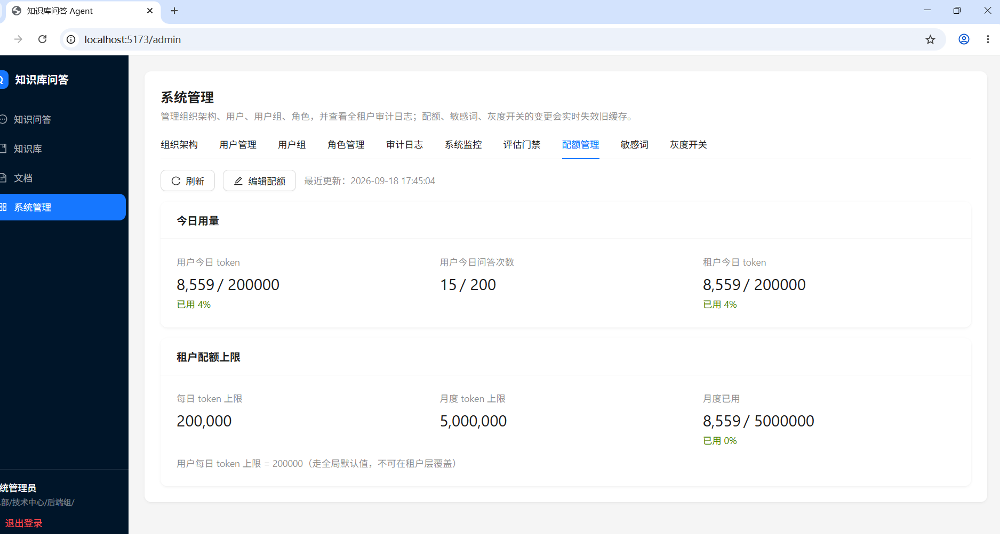

# 企业知识库问答 AI Agent

> **私有化部署的企业级 RAG 问答系统** —— 一个人，从产品方案、前端、后端到部署全链路独立完成。


上传企业文档（PDF / Word / PPT / Excel / Markdown / 纯文本 / 图片）→ 解析、**内嵌图视觉转录**、分块、向量化 → **带引用溯源的流式问答**。内置组织架构权限隔离、chunk 级密级管控、**三级记忆层**、知识治理四维审查、审计追溯、配额限流、提示注入防护与灰度开关 —— 面向**数据不允许出内网**的政企私有化场景设计。

---

## 目录

| 章节 | 内容 |
|---|---|
| [一、解决什么问题](#一这个项目解决什么问题) | 通用大模型在企业内的六个硬伤，以及本项目的对应解法 |
| [二、演示](#二演示) | 流式问答、引用回跳、拒答 |
| [三、能力全景](#三能力全景) | 检索生成 / 多模态解析 / 治理安全 / 记忆上下文 / 工程，五组能力与代码入口 |
| [四、RAG 全链路](#四rag-全链路) | 端到端流程 + 三级记忆 + 上下文治理 |
| [五、八个设计取舍](#五八个设计取舍) | 为什么这么选，以及不这么选会怎样 |
| [六、多模态解析](#六多模态解析图表与扫描件) | 八类格式、内嵌图转录、图片式表格、质量门禁、水印清理 |
| [七、知识治理](#七知识治理四维审查) | 四维评分、检索加权、独立任务与失败降级 |
| [八、性能实测](#八性能实测与架构约束) | 压测数据、连接池缺陷、视觉链路吞吐天花板 |
| [九、容器拓扑与技术栈](#九容器拓扑与技术栈) | 10 服务拓扑、技术选型 |
| [十、快速启动](#十快速启动) | 三条命令跑起来 |
| [十一、功能清单](#十一功能清单) | F01–F38 |
| [十二、目录结构](#十二目录结构) | 代码地图 |
| [十三、工程质量](#十三工程质量) | 契约驱动开发、评测门禁、自检发现的缺陷 |
| [十四、已知边界](#十四已知边界明确说清不做什么) | 明确说清不做什么 |
| [十五、部署](#十五部署) | 本地 / 内网 / 外网 / 生产 |
| [十六、常见问题](#十六常见问题) | 常见问题 |

---

## 一、这个项目解决什么问题

企业内部的知识散落在 PDF、Excel、Word、PPT、Wiki 里，员工查资料靠翻盘 + 问同事；直接上通用大模型又有六个绕不过去的坎：

| 问题 | 通用大模型的短板 | 本项目的解法 |
|------|------------------|--------------|
| 数据不能出内网 | 公有云 API 直连不可接受 | 全链路私有化：Docker Compose 一键起，嵌入/重排本地 CPU 推理，LLM 可对接内网兼容接口 |
| 大模型会编造 | 无依据也给一个像样的答案 | **严格只依据知识库作答**：检索为空 → 引用双向校验 → 拒答，绝不编 |
| 答了不敢信 | 无法核实依据 | 回答与 chunk 双向绑定，引用角标 `[1]` 点击回跳原文；不脱敏的原文、脱敏的回答分开处理 |
| 文件权限复杂 | 一个"能问答"的 demo 不解决治理 | 权限、脱敏、审计、限流、灰度五层治理，权限过滤**下推到检索层**（不可见的内容根本不进模型上下文） |
| 知识藏在图和表里 | 纯文本抽取把表格拍平、把截图丢光 | 表格按行列结构化；**docx / PDF / Excel / PPT 的内嵌图经视觉模型转录入库**，图片式表格还原成表格块 |
| 越用越"串味" | 无记忆就每次重新说；有记忆又容易把不该记的记下来 | **三级记忆层 + 写入过滤器**：短期/长期/永久分层，长期记忆只收"偏好"、每条带来源可反查、用户可查看可删除 |

一句话：**一个 RAG demo 和企业级系统的差距在治理层，也在"脏数据能不能变成干净知识"这一层。** 这个项目把两层都做了。

---

## 二、演示

| 流式问答 + 引用溯源 | 管理面板（12 个） |
|:---:|:---:|
|  |  |

- Token 级 SSE 流式输出（打字机效果），回答中的 `[1]` `[2]` 引用角标可点击回跳原文片段
- 知识库中检索不到依据时**直接拒答**，不编造；问题本身不明确时**反问澄清**，不消耗一次注定失败的检索
- 断网导致流中断 → 保留已流出的文本、给出重试按钮（不是一句"请求失败"把内容清空）
- 图片提问与图片入库：单轮最多 3 张图，图中文字经视觉模型转录后与文本知识同一套检索

> 截图与动图存放于 [code/docs/screenshots/](code/docs/screenshots/)。

---

## 三、能力全景

### 检索与生成

| 能力 | 具体实现 | 代码入口 |
|------|----------|----------|
| 混合检索 | bge-m3 向量召回（1024 维）+ tsquery 全文 + ILIKE 子串**三路** → RRF 融合 → bge-reranker 重排（默认关）→ **0.50 相关性阈值闸门** | [services/retrieve](code/apps/api/app/services/retrieve/__init__.py) |
| 链式检索 | 复用 Query 改写的百分制评分当复杂度信号，难题才拆成多个子查询分轮检索；拆解失败内部降级单趟，对下游是同一个结果契约 | [services/retrieve/chain.py](code/apps/api/app/services/retrieve/chain.py) |
| Query 改写 | 检索前先给问题**百分制打分**（明确度 + 检索友好度 − 指代依赖），≥90 直接用原问，<90 才改写；一次 LLM 调用完成"评分→决策→改写" | [services/query_rewrite.py](code/apps/api/app/services/query_rewrite.py) |
| 澄清反问 | 评分 <90、改写未产出可用 query、且会话无历史可消解 —— 三个条件同时成立才反问，SSE 事件 `refused / NEED_CLARIFICATION` | [api/chat.py](code/apps/api/app/api/chat.py) |
| 引用溯源 | 回答与 chunk 双向绑定，引用角标点击回跳原文 | [ChatPage.tsx](code/apps/web/src/pages/ChatPage.tsx) · [services/generate](code/apps/api/app/services/generate/) |
| 回答边界 | 检索为空 → 拒答；有答案则走**引用双向校验**（答案→引用剥离无效行 / 引用→检索结果只留模型真用过的），严格只依据知识库作答 | [services/grounding](code/apps/api/app/services/grounding/) |
| 思维链分级 | `adaptive`：复用 Query 改写分当复杂度信号（省掉一次额外 LLM 调用），**只对难问题开启**；推理链用 `<reasoning>` 包裹，流式层剥离不外发、仅落库审计 | [services/generate](code/apps/api/app/services/generate/__init__.py) |
| 拒答判定 | 不靠字符串等值，而是**归一化 + 首句语义匹配**：剥标题、部分确认型、名词收尾、绕道作答、零引用按 3-gram 重合度区分（"概括得准但漏标引用"放行，"凭空作答"拒绝） | [services/generate](code/apps/api/app/services/generate/__init__.py) |

### 多模态解析

| 能力 | 具体实现 | 代码入口 |
|------|----------|----------|
| 八类格式 | PDF / docx / pptx / xlsx / xls / md / txt / 图片（13 个扩展名）；PDF 表格走 pdfplumber，扫描件走 OCR 分段管线 | [services/parse](code/apps/api/app/services/parse/) |
| **文档内嵌图转录** | docx / PDF / xlsx / pptx 里的图片抽出来，过滤小图与重复图后经视觉模型转成文本块，**插回原位置**（段落下方 / 单元格内 / 该页末尾） | [services/parse/embedded_images.py](code/apps/api/app/services/parse/embedded_images.py) |
| **图片式表格结构化** | 视觉模型用 `<TABLE>` 标记 + TSV 输出，解析层还原成 `is_table` + 表头，**继承与文本表格完全相同的切片与回捞路径** | [services/multimodal/vision.py](code/apps/api/app/services/multimodal/vision.py) |
| 聊天带图 | 单轮最多 3 张，`storage_key` / `data_url` 二选一；转录文本拼进问题后走既有检索生成链路 | [api/chat.py](code/apps/api/app/api/chat.py) · [schemas/chat.py](code/apps/api/app/schemas/chat.py) |
| **图像质量门禁** | 纯 Pillow 启发式，三档判决 `pass` / `enhance` / `reject_to_manual`；检测噪点、污渍、倾斜、水印、红章、摩尔纹、灰底，单页 <200ms | [services/parse/image_quality.py](code/apps/api/app/services/parse/image_quality.py) |
| **水印识别与文本清理** | 只识别不擦像素（保护原图一致性与密级标识）；真正处理的是**文本层污染** —— 剥离水印行、页内重复行、跨页页眉行，实测单页 CER 72.13% → 0.98% | [services/parse/image_quality.py](code/apps/api/app/services/parse/image_quality.py) |
| 扫描件 OCR | 仅 PDF 扫描页走本地 OCR 服务，按段渲染（≤8 页/段、≤200 页/文档），并发闸 `OCR_MAX_CONCURRENCY=1` | [services/ocr.py](code/apps/api/app/services/ocr.py) |
| 解析预览 | `GET /documents/{id}/parse-preview`：图片/PDF 左原图右文本同屏，文本取**真实入库的 chunk**（不是重放解析） | [api/documents.py](code/apps/api/app/api/documents.py) |

### 治理与安全

| 能力 | 具体实现 | 代码入口 |
|------|----------|----------|
| chunk 级权限 | 四闸门判定（KB 成员 + 密级 + 拒绝标签 + 部门可见），权限过滤以 SQL WHERE **下推到检索层**，变更即时失效 Redis 缓存 | [services/acl](code/apps/api/app/services/acl/visibility.py) |
| **知识治理四维审查** | 时效性走规则（零 token），权威性/一致性/完整性走一次 LLM；加权合成 `governance_weight` 参与检索排序 | [services/governance](code/apps/api/app/services/governance/__init__.py) |
| 提示注入防护 | 8 条规则 / 4 类模式（指令覆盖 / 角色改写 / 数据外发 / 越权诱导）检测召回片段，命中**降权不丢弃** + 指标 `rag.injection.hit` | [services/guard/injection.py](code/apps/api/app/services/guard/injection.py) |
| 密级脱敏 | 4 档密级（公开/内部/机密/绝密），回答中手机号/身份证/银行卡自动打码（引用原文不打码） | [services/mask.py](code/apps/api/app/services/mask.py) |
| 限流与配额 | Redis 令牌桶（单用户 20 次/分钟）+ 用户/租户双层 token 配额 + 四级降级 | [services/quota.py](code/apps/api/app/services/quota.py) |
| 灰度开关 | 按部门 / 百分比放量，关闭即秒级回滚 | [services/feature_flag.py](code/apps/api/app/services/feature_flag.py) |
| 审计追溯 | 谁、何时、问了什么、引用了哪些文档、拒答原因；`trace_id` 贯穿请求 → 审计 → 异步任务 | [api/audit.py](code/apps/api/app/api/audit.py) · [infra/trace.py](code/apps/api/app/infra/trace.py) |

### 记忆与上下文

| 能力 | 具体实现 | 代码入口 |
|------|----------|----------|
| **三级记忆层** | 短期（会话）/ 长期（用户偏好）/ 永久（系统口径）+ **写入过滤器** + 来源可反查 + 用户可查看可删除 | [services/memory.py](code/apps/api/app/services/memory.py) |
| 上下文治理 | 短期记忆（最近 3 轮）+ 长期画像（≤20 条事实）+ 32K 窗口预算 + 递归压缩 + 压缩超阈值提示新开对话 | [services/memory.py](code/apps/api/app/services/memory.py) |
| 答案口径快照 | 每条助手消息落 `meta.caliber` 快照（无 IO 同步构建），可按口径反查；配套 messages.meta GIN 索引 | [services/caliber.py](code/apps/api/app/services/caliber.py) |

### 工程与可观测

| 能力 | 具体实现 | 代码入口 |
|------|----------|----------|
| 指标可观测 | `prometheus_client` 标准指标 + `/metrics` 端点（路径标签用路由模板，避免高基数）；admin 指标接口另聚合 **TTFT（P50/P95/P99）** 与**三路召回 covered/unique 贡献** | [infra/metrics.py](code/apps/api/app/infra/metrics.py) · [api/audit.py](code/apps/api/app/api/audit.py) |
| 提示词版本管理 | **8 个提示词**的锁定区（角色 / 合规约束 / 拒答文案 / 表格标记协议，代码内置不可在线改）与可编辑区（落库、可切换版本）分离；激活前校验 + Redis 60s 缓存、写后失效 | [services/prompt_registry.py](code/apps/api/app/services/prompt_registry.py) · [config/prompts.py](code/apps/api/app/config/prompts.py) |
| 索引 / 口径版本 | `IndexProfile` 单一真源（embedding_model / dim / text_version / chunker_version），指纹取 SHA1 前 12 位；检索按口径过滤（fail-closed），重算脚本支持 `--check` 检测过期 chunk | [config/index_profile.py](code/apps/api/app/config/index_profile.py) · [scripts/reindex_embeddings.py](code/apps/api/scripts/reindex_embeddings.py) |
| 评估门禁 | **206 条** eval 用例集（103 可答 + 103 不可答，覆盖 11 类场景）自动跑检索 + 生成，判定"该答的答了 / 不该答的拒了" | [services/eval_service.py](code/apps/api/app/services/eval_service.py) |
| 微调样本闭环 | 用户采纳的问答自动落库，admin 分页查看 + 导出打标（增量取出），为后续微调备好数据资产 | [api/finetune.py](code/apps/api/app/api/finetune.py) |

### 规模

| 维度 | 数字 |
|---|---|
| 前端 | React 18 + TypeScript，**5 个业务页面 + 12 个管理面板** |
| 后端 | FastAPI，**21 个 REST 路由模块 / 80 个接口 / 19 版 Alembic 迁移** |
| 解析 | **8 类格式 / 13 个扩展名**，四类文档支持内嵌图转录 |
| 测试 | **41 个测试文件 / 551 个用例**，行覆盖 **64%**（8763 行语句） |
| 评测 | **206 条** eval 用例（103 可答 + 103 不可答） |
| 容器 | 开发 10 服务、生产 12 服务（含迁移 / 网关 / 监控）一键启动 |

---

## 四、RAG 全链路

### 4.1 文档入库

```
文档上传 → MinIO → worker(arq) 异步解析
                        │
        ┌───────────────┴────────────────┐
   文本层链路                        视觉链路
   PDF / docx / pptx /              图片文件（直接上传 / 聊天带图）
   xlsx / xls / md / txt            docx · PDF · xlsx · pptx 内嵌图
        │                                 │
        │                        图像质量门禁（pass / enhance / reject）
        │                                 │ 纠偏 · 去噪 · 去污 · 拉伸
        │                                 ▼
        │                          视觉模型转录
        │                    ┌────────────┴────────────┐
        │                 普通图                    表格图
        │              [图片转录] 文本          <TABLE> → TSV + 表头
        │                    │                         │
        │                    │                  is_table 块（整表不切）
        └────────────┬───────┴─────────────────────────┘
                     ▼
        分块（表格整表不切 / 超限按行组切并前置表头）
                     ▼
        bge-m3 向量化（1024 维）→ pgvector 入库
                     ▼
        知识治理四维审查（独立 arq 任务，不阻塞主路径）
```

### 4.2 问答

```
用户提问 → 敏感词拦截 → Query 打分 ──┬─ ≥90：原问直接检索
                                     ├─ <90：改写后检索（改写只用于检索）
                                     └─ <90 且改写失败且无历史 → 澄清反问

              权限过滤(SQL 下推) → 向量 + tsquery + ILIKE 三路召回
                     ▼
              RRF 融合 → 重排（默认关）→ 0.50 阈值闸门
                     ▼
        ┌──命中──┐                    ┌──未命中──┐
        ▼        │                    ▼
  注入检测(降权) + 三级记忆 + token 预算裁剪      拒答
        │
        ▼
  拼 Prompt → LLM SSE 流式 → 引用双向校验 → 拒答判定
        │
        ▼
  前端 Token 级渲染 + 引用回跳 → 密级脱敏 → 审计落库 → 配额扣减
```

### 4.3 三级记忆层

| 层级 | 定义 | 落点 | 收什么 / 不收什么 |
|------|------|------|-------------------|
| **短期** | 单次会话内有效 | `Message` 表（按 `conversation_id` 读，单次上限 500 行），会话内按 token 预算压缩 | 多轮对话历史；**不落 Redis** —— 换设备/刷新后上下文仍在 |
| **长期** | 跨会话、按用户持久 | `users.memory` JSONB（`{profile, facts}`） | **只收 `kind=preference`**（身份、偏好、技术栈）；检索到的文档片段禁入 |
| **永久** | 系统级行为定义 | 口径版本表 | 阈值 / 提示词 / Schema / 分块口径，**只追加不修改** |

**为什么短期记忆不落 Redis（刻意选择，不是遗漏）**：Redis 无持久化会丢两件事 —— **多端同步**（A 设备问了一半，B 设备打开没有上下文）与**刷新恢复**（刷新页面历史消失）。所以"短"体现在**压缩与裁剪**，不是存储介质的易失性。

### 4.4 上下文治理的四个口径

（都在 [config/decisions.py](code/apps/api/app/config/decisions.py) 里冻结、可被单测 monkeypatch 锁死）

| 口径 | 值 | 为什么 |
|------|-----|--------|
| 短期记忆 | 最近 6 条（3 轮） | 再往后对当前轮的价值衰减很快，占的却是最贵的 prompt 预算 |
| 长期记忆 | 只收 `preference` / ≤20 条事实 / ≤800 字符 | 只留跨对话稳定的信息，"好的""让我看看"这类不进画像 |
| 单请求窗口 | **32K token**（预留 4K 输出） | 超限则**递归压缩** history + 裁剪 chunks 直到达标 |
| 改写历史预算 | **12K token**（与生成同窗口，独立预算） | 曾按 128K 窗口写死 32K，与 32K 生成的模型窗口不匹配：长会话时改写请求静默超窗回退，改写与链式检索双双失效 |

同一会话被压缩超过 **3 次**，后端通过 SSE `context_warning` 事件提示用户"新开对话重置上下文"—— 与其让模型在一条被压扁的历史上下文中越答越糊，不如把选择权交给用户且说清楚原因。

### 4.5 记忆写入的四道关

写入长期记忆不是"把对话存下来"，而是**提炼 → 过滤 → 门槛 → 留痕**：

1. **提炼**：会话结束时由 LLM 抽取结构化事实，不是复制 transcript
2. **过滤**：11 条 `BLOCKED_MEMORY_PATTERNS`（引用痕迹、拒答文案、密级标识、内部字段名、过短/过长…）
3. **门槛**：置信度 < 0.6 不入库，单条 4~60 字（用长度粗粒度区分"偏好"与"片段"，无需额外 LLM 调用）
4. **留痕**：每条 MUST 带 `source_trace_id` —— 这是权限变更时**按文档反查清除的唯一依据**

**读取侧**走白名单：只召回 `kind=preference` 且 `scope=user` 的项，且 prompt 必须从 `facts` 重建（**不读 `profile` 快照** —— 快照无法按 `kind` 过滤，直接用它白名单就形同虚设）。

---

## 五、八个设计取舍

**1. 为什么关键词召回要做到三路（向量 + tsquery + ILIKE），而不是单路向量？**

纯向量召回在专业术语、编号、人名上会漏（"F09"和"F10"在向量空间几乎重合）。关键词路分两条是有原因的：`tsquery`（走 `idx_chunk_fts` 索引）负责**英文/数字词元**的精确匹配，但 PostgreSQL 的 `simple` 配置**不做中文分词**；中文只能靠 `ILIKE` 子串匹配兜底。两者都不完美，但**漏的地方不一样**，叠加才拿得回大部分本该命中的片段。

三路之后用 **RRF 融合**：RRF 只看**排名**不看分数，天然规避了多路分数量纲不可比的问题（向量相似度 0~1、`ILIKE` 是布尔、`tsquery` 是 rank），也不需要为每一路调权重参数。融合后再走 bge-reranker 精排 —— 召回要宽（`TOP_K_RECALL=50`），重排要准（`TOP_K_RERANK=8`）。

**2. 为什么权限过滤要下推到检索层 SQL，而不是检索后再过滤？**

检索后过滤有两个致命问题：一是**数据已经进了上下文**，模型可能在回答里"顺嘴"说出来（越权泄露）；二是过滤后可能只剩 1~2 条，甚至 0 条但系统仍以为检索命中了。所以四个闸门写成 SQL `WHERE` 的一部分，让不可见的内容**从未进入候选集**。代价是权限变更要立即失效 Redis 缓存（`acl_tags` 重算）—— 这个代价是必须付的，缓存的 5 分钟不一致在权限场景是不可接受的。

**3. 为什么 Query 改写只用于检索、不用于生成？**

改写是"为了检索更好命中"做的扩写（补全指代、口语转术语），它**不是**用户的原话。如果拿改写后的 query 去生成，等于让模型回答一个用户没问的问题 —— 所以改写结果只喂 retrieval（HyDE 模式），generation 始终使用原始 question。同理，打分刻意用**一次** LLM 调用完成"评分 + 决策 + 可选改写"，省掉一次调用的首字延迟；超时 5s 或 JSON 解析失败就静默回退原问题，绝不因为一个优化项把主链路拖死。

同一条链路上还有**澄清反问**：问题不自包含（评分低）、改写也没能补出可用 query、会话里又没有历史可以消解 —— 此时带原问题去检索，几乎必然换来一次 `NO_RELEVANT_CONTENT`。与其消耗一次检索 + 一次生成换一句"未找到相关内容"，不如直接反问"请补充具体对象"。

**4. 为什么长期记忆只记"用户偏好"，不记"检索到的内容"？**

因为**权限是实时的，画像副本不是**。如果把会话里检索到的文档片段沉淀进用户画像，就出现这样一条时间线：

```
今天：用户有权看 A 文档  → 检索到 → 提炼进画像
明天：权限被收回         → 检索层的四闸门立刻拦住
                          但画像里那份副本还在 → 等于绕过了守卫
```

这是企业知识库最真实的风险点，所以长期记忆做了双向防护：**写入过滤器** + **读取白名单**。两者是**双保险而非重复** —— 模型换个说法可以绕过正则，但绕不过 `kind` 字段；任一侧失守，另一侧仍能挡住。

配套的合规能力是**用户可查看、可删除自己被记了什么**（`GET /api/me/memory` 等三个端点，**物理删除**而非标记删除 —— 标记删除的副本仍在 JSONB 里，等于没删），且这三个端点**不接受 `user_id` 参数**，从接口形态上就排除掉"查看/删除他人画像"。

**5. 为什么水印只识别、不擦除？**

擦掉水印看起来更"干净"，但会同时毁掉三样东西：**答案可回溯原文**的承诺（像素被改过，回跳看到的不是原件）、**版权与密级标识**（"内部资料 严禁外传"本身就是要留的证据）、以及转录的可信度（inpaint 会在笔画上补出并不存在的像素）。

真正影响知识质量的是**水印进了文本层**：每页重复的"机密 编号 XXX-2024-001"被读出来，进了 chunk、进了 embedding、进了 top-k 候选，最后可能被当成答案引用。所以本项目做的是两件事：

- **图像层识别**（`watermark_detected`）：作为质量信号与转人工依据，不改像素
- **文本层清理**（`strip_watermark_text` / `strip_repeated_page_lines`）：把水印行、跨页重复的页眉行剥掉，只留正文

实测效果：一张平铺水印的扫描页，文本清理前 CER **72.13%**，清理后 **0.98%**（降 71.15 个百分点）。

**6. 为什么图片走视觉 LLM，而不是本地 OCR 服务？**

因为 OCR 只能给"一行行文字"，给不了**结构**。一张产品参数表的截图，OCR 出来是几个孤立的词，知识在"这一行的型号对应这一列的延迟"这种**行列绑定**上，OCR 恰好把它拍平了。

改用视觉模型后，同一个出口能拿到三样东西：普通图 → 逐字转录；表格图 → `<TABLE>` 包裹的 TSV + 首行表头；图表 → 「标签: 数值」成对输出。表格图一旦变成 `is_table` 块，就自动继承文本表格的**整表不切 / 行组切带表头 / 跨片回捞**，不必为"图里转出来的表"再写一套切分逻辑。

代价是：图片入库从此依赖**多模态模型**，而不是一个可以离线自持的 OCR 容器。所以本地 OCR 服务并未删掉 —— 它现在专职服务**扫描件 PDF**（整页渲染、无表格结构可恢复，OCR 更划算），图片文件与文档内嵌图才走视觉链路。

**7. 为什么连接池要按"在途请求"标定，而不是按"QPS × 平均耗时"？**

因为这条链路是 **SSE 长连接**：`get_db` 的 `yield` 覆盖整条流的生命周期，请求不结束连接就不归还；流式过程中还存在瞬时占两条（依赖注入的 session + 内部 `SessionLocal`）的窗口。按 QPS 估会严重低估。

这个错误在压测里直接暴露：池 10+10=20 时，**20 并发 47.37% 失败**、P50 总耗时 60.1 秒、日志 615 次 `QueuePool limit of size 20 overflow 20 reached`。改为 20+20=40、`pool_timeout` 30s → 5s 之后，同样 20 并发 **0 失败**。过载时应快速返回 503，而不是挂 30 秒再返回 500。

**8. 为什么治理分只给 ±0.05 的权重，而不是直接改检索阈值？**

治理分（0–100 加权）合成后减 50，映射到 [-50, +50]，再乘 `GOVERNANCE_WEIGHT_SCALE=0.001`，也就是对最终得分最多 ±0.05。这个量级是刻意选的：**能改变同分文档的排序，但推不过 0.50 的相关性阈值**。如果让治理权重更大，"一份写得规范但不相关"的文档会被推成答案——治理是排序信号，不是相关性判定，两者混在一起就没法解释"为什么这条被拒答"。

---

## 六、多模态解析：图表与扫描件

### 6.1 八类格式，三条链路

| 链路 | 输入 | 引擎 | 为什么 |
|---|---|---|---|
| 文本层 | PDF（有文本层）/ docx / pptx / xlsx / xls / md / txt | pdfplumber / python-docx / python-pptx / openpyxl / xlrd | 保留段落、标题层级、表格行列 |
| 视觉链路 | 图片文件、docx·PDF·xlsx·pptx 的内嵌图、聊天带图 | 多模态 LLM（`vision_extract` 提示词） | 图里的知识只能靠"看"，结构化输出靠提示词锁定 |
| OCR | 扫描件 PDF 的每一页 | 本地 `apps/ocr`（GOT-OCR2.0） | 整页无结构，OCR 更快更省；按段渲染避免 OOM |

三条链路的产物是**同一个契约** `ParsedBlock`，下游分块、向量化、检索、治理完全不区分"这条知识是从文字来的还是从图来的"。这是有意的：一旦为图片单开一套向量空间或第二套检索，RRF 融合、阈值、权限过滤全要重写一遍。

### 6.2 内嵌图：从"被丢掉"到"进知识库"

旧版本只取 docx 文本层，图里的信息直接丢弃。现在的处理顺序是**先过滤、后转录**，因为过滤是零成本的、转录是贵的：

| 步骤 | 判据 | 结果 |
|---|---|---|
| 1. 可解码 | Pillow 打得开 | 打不开 → 跳过（损坏文件不该拖垮整篇） |
| 2. 面积 | 解码后 < 100×100 px | 跳过 —— 图标、箭头、装饰线没有知识 |
| 3. 字节 | < 1KB | 跳过 —— 只兜"近乎空白/损坏" |
| 4. 去重 | 字节 sha1 已出现过 | 跳过 —— 页眉 logo 逐页重复，转录一次就够 |
| 5. 预算 | 段落图 8 张 / 单元格图 30 张（**分开计**） | 跳过 —— 防"图堆文档" |
| 6. 转录 | 视觉模型 | 无可读内容 → 跳过并计数；链路故障 → **整个文档失败**（fail-closed） |

三个不显眼但关键的细节：

- **面积是唯一小图判据，字节数不是**。扁平色块图表压缩率极高：一张 600×420、含标题与三根柱状图的 PNG 只有 4585 字节，旧版按 5KB 门槛把它当"小图"跳过，整张图表的知识直接丢失。PNG/JPEG 的字节数反映的是**画面复杂度**，不是信息价值 —— 越工整的图压得越小。
- **两类图分开预算**。段落图少而信息密度高；表格单元格图常成批出现（产品目录一表 30 行、每行一张缩略图）。合用一个 8 张预算时，段落循环先跑、先占满额度，图片表一张都转不了。
- **转录块要插回原位**，不是统一堆到文末。docx 插在所属段落之后、heading 跟随标题栈；PDF 插在该页最后一块之后并带 `page_no`；xlsx 按锚点定位（锚点格有字就拼进该格，空格或越界才独立成块）；pptx 插在该页。图的知识长在上下文里，堆到文末等于丢掉它的归属。

### 6.3 图片式表格：一个标记协议，复用整条表格链路

视觉模型的锁定提示词里有一条硬约束：**识别到表格时，整张表必须包在 `<TABLE>` 与 `</TABLE>` 之间，首行表头、每行一条记录、单元格用制表符分隔，标记之外不得输出任何其它文字。**

解析层据此做三件事：剥掉标记（它是给解析层的信号，不是用户可见内容）、校验形态（≥2 行且 ≥2 列，否则按普通文本返回 —— 模型偶尔会给单行文字也套标记）、补齐参差行到等宽（TSV 行必须等宽，否则按 Tab 数推列会错位）。然后返回 `is_table=True` + 表头。

由此，一张 Excel 截图、一张拍照的报价单、PPT 里的一页参数表，会和正文里的表格享受**完全相同的待遇**：整表不切、超限按行组切且每组前置表头、跨片回捞。不需要为图片表格写第二套分片逻辑。

同一机制也约束了反向场景：**文本表格的单元格里如果嵌了一张图**，转录文本必须压平成单行（换行 → ` / `，Tab → ` | `）再拼进单元格，否则一格内容会把整行的行列绑定打散。

### 6.4 md / html 里的图片：清掉噪音，留下语义

Markdown 与 HTML 里的 `` 有两种命运，取决于有没有 `alt`：

| 情形 | 处理 |
|---|---|
| 有 alt（``） | 替换成 `[图片] 拓扑图`，URL / base64 data URI 整段丢弃 |
| 无 alt | 整段丢弃 —— 占位图、追踪像素、装饰线没有知识 |
| 徽章 / 引用式 / `` 标签 | 统一同上口径；围栏代码块与 `<pre>` 内保真不替换 |
| `<figcaption>` 图注 | 纳入正文标签，图注不再被当噪声丢掉 |

不这么做会怎样：一份从 Wiki 导出的 Markdown，正文里塞满 `https://cdn.xxx/aaa.png` 这种长 URL —— 它们会进 chunk、进 embedding，把检索词污染成"一串看起来像身份证号的东西"。

### 6.5 图像质量门禁

上传的图片与扫描件在转录之前先过一道**质量判决**，输出三档之一：

| 判决 | 触发条件（任一） | 后续动作 |
|---|---|---|
| `reject_to_manual` | 短边 < 500px / 倾斜 > 8° / 孤立暗点 > 6% | 不入库，提示重扫或补拍 |
| `enhance` | 倾斜 > 1.5° / 暗点 > 0.3% / 厚暗区 > 2% / 灰底 | 先纠偏、去噪、去污、拉伸对比度，再转录 |
| `pass` | 以上都不命中 | 直接转录 |

**水印不改变判决**：它单独打 `watermark_detected` 标记并追加一条 reason，`verdict` 仍是 `pass` 或 `enhance` —— 因为水印不影响读字，影响的是文本内容，处置交给下游的文本清理。

检测项与口径（全部在 `decisions.py` 冻结）：

| 项 | 判据 | 关键教训 |
|---|---|---|
| 噪点 | 孤立暗点占比（暗像素且 3×3 邻域暗点 ≤1） | 不用"中值滤波残差"——笔画边缘会被误算成 5% 噪声，把干净页全推向增强 |
| 污渍 | 5×5 腐蚀后仍存活的厚暗区占比 | 暗区阈值定 90 时，高斯模糊后污渍边缘灰度升到 100–150，整块污渍算出 **0%**；改 128 后同图 2.17% |
| 倾斜 | 旋转穷举 + 行投影方差 | 1.5° 是增强线，8° 是转人工线 |
| 水印 | 浅灰窄峰 + 6×6 分块覆盖 ≥30% + 块间离散度 ≥2.0 | 缺"离散度"会把摩尔纹判成水印覆盖 100%；缺"分块"会把整页偏灰判成水印。命中只标记，不改判决 |
| 红章 | R−G / R−B 色差成片 | 识别为"有盖章"，不参与质量判决 |
| 摩尔纹 | FIND_EDGES 高频纹理占比（`high_freq_score`） | 只采集、不参与判决 —— 与红章同理，留着做事后分析 |
| 灰底 | 背景电平（灰度 80 分位）∈ [180, 240] | 不能用"浅灰占比 >35%"——复印件背景占 96%，会被水印上限挡掉，结果既不判脏也不增强 |

**为什么不用 OpenCV / 模型**：单页要控制在 200ms 内且不能加容器。Pillow 的 C 路径足够算这些统计量；引入 OpenCV 会让镜像大一个量级，引入模型则与"私有化 CPU 部署"的定位冲突。

**已知漏检（如实标注）**：斜向大字水印的图像层覆盖率只有 0.14，低于 0.30 的块覆盖门槛；页眉单行水印的图像层覆盖为 0。这两种由**文本层规则**兜底（密级短语、文号正则），不依赖图像层。

### 6.6 水印对知识的污染怎么清除

文本层清理走四类规则，命中即删行，同时设了**删除比例上限 30%**——超过就判定"命中了正文里的密级词汇"（例如整章《商业秘密管理办法》），放弃清理、回退原文并告警：

| 规则 | 认什么 | 阈值 |
|---|---|---|
| 密级短语 | "内部资料""严禁外传""请勿外传""受控文件"… | 行长 ≤ 80 字（不受"无句末标点"约束） |
| 机构 + 文号 | `XX-2024-001` 形态 + "公司/集团/编号/归档" | 行长 ≤ 50 字 |
| 页内重复行 | 同一短行在一页内出现 ≥2 次（平铺水印特征） | 行长 ≤ 60 字且不含句末标点 |
| 跨页重复行 | 同一短行出现在 ≥ max(2, 30% 页数) 的页上（页眉页脚） | 行长 ≤ 60 字且不含句末标点 |

两档行长上限不是随手定的：真实水印行归一化后 42~43 字（公司名 + 编号），30 字会把水印当正文保留；而正文引用文号的行多在 60 字以上，50 字正好把两者分开。

**表格块不做清理**：清理依据是"短行 / 重复行"，而 TSV 的数据行天然短且可能重复（同一型号出现在多行），删掉等于是把数据行当水印删了——结构还在，知识没了。

反向保护也测过：正文里**引用**文号（"依据 XX-2024-001 文件"）不会被删，超长行不会被误判，带句号的水印行仍能删（由强特征档兜住）。

### 6.7 视觉链路的实测吞吐

> 数据来自 2026-10 的 8 次采样，接多模态 API 代理（`deepseek-v4-flash` 视觉路由），单线程串行。

| 场景 | 单次耗时 | 说明 |
|---|---|---|
| 小图柱状图（7KB） | 1.17 / 2.70 / 3.70 / 3.48 / 2.24s | 与图片体积**无明显相关** |
| 截图级 JPEG（177KB） | 4.96 / 1.83 / 2.28s | 同上 |
| 单图均值 | **2.7 ~ 3.0s** | 提示词改版（结构化输出）后从 4~5s 降到这个量级 |
| 30 张单元格图 | 平均约 85s，峰值约 150s | 覆盖 30 行"一行一图"的规格表 |
| 单文档最坏 | 约 190s（30 张单元格图 + 8 张段落图） | 远低于 `parse_job_timeout` 1800s，但已占住 worker 槽位 1.5~3 分钟 |

**这个数字决定了预算上限为什么是 30 而不是 100**：它不是技术上限，是"延迟 × 覆盖"的取舍点。再往上加之前，必须先确认上游吞吐与并发，否则多个含图文档会长时间挤占解析队列。

---

## 七、知识治理：四维审查

文档入库后不是"能搜到就完了"。一份三年前的技术方案、一份没有出处的截图、一份只有结论没有依据的纪要，都能被检索命中 —— 治理层要回答的是"这条知识值不值得排在前面"。

### 7.1 四个维度与判据

| 维度 | 权重 | 判据 | 引擎 |
|---|---|---|---|
| 时效性 `freshness` | 0.35 | `expire_at` 过期 → 0 分；`effective_at` 未到 → 10 分；否则按 `created_at` 距今分档：≤90 天 90 分 / ≤180 天 75 / ≤365 天 55 / ≤730 天 35 / 更老 15 | **纯规则，零 token** |
| 权威性 `authority` | 0.30 | 是否有明确出处、发布主体、编号 | LLM |
| 一致性 `consistency` | 0.20 | 与同库其它文档是否矛盾 | LLM |
| 完整性 `completeness` | 0.15 | 是否有结论缺依据、有步骤缺前置 | LLM |

前三维合成 `governance_weight`（0–100 加权 → 减 50 → [-50, +50]），检索期在重排之后做 `final_score += weight × 0.001`，最大偏移 ±0.05。

### 7.2 三条不变量

- **审查是独立任务**：`run_parse_job` 主路径零调用，治理由独立的 arq 任务 + cron 扫描（每 10 分钟一轮、每轮最多建 50 个任务）驱动。解析入库不等治理，治理慢不该拖慢入库。
- **只写治理字段**：结论落 `documents` 的治理列 + `governance_report`，并同步 `chunks.governance_weight`；**不碰** `content` / `filename` 等原文。审查不能成为"顺手改内容"的口子。
- **失败降级为"未审查"**：审查失败不写治理分（weight 保持 0），检索按基础分照常工作；重试达上限置 `failed`，由 admin 在「知识治理」面板手动重跑（`POST /documents/{id}/governance/rerun`）。

### 7.3 为什么要单独做治理，而不是调阈值

因为**相关性和质量是两件事**。阈值回答"这条能不能用"，治理回答"这条该不该排在前面"。混在一起就出现两个都没法解释的局面：一份高相关但过期的文档被拒答（其实是该答、但该降权），或者一份格式规范但不相关的文档被推成答案（治理分高≠相关）。

分开之后，每个拒答都能归因到具体一层：是检索没命中（阈值）、还是权限挡住了（ACL）、还是模型没引用（grounding）。

---

## 八、性能实测与架构约束

> **口径先说清**：以下并发数字在开发机（16 核 / 无 CPU 配额 / Windows + Docker Desktop）上测得，用**本地 OpenAI 兼容桩**隔离上游（桩按 400ms 首 token、15ms/token、120 token 建模）。它**不能**作为"这台服务器能扛 N 并发"的容量承诺，换机器数字会变。这里真正有价值的是**结论与缺陷**，不是绝对值。

### 8.1 修复前：20 并发雪崩

| 并发 | QPS | 失败率 | P50 总耗时 | 峰值连接 |
|---|---|---|---|---|
| 1 | 0.31 | 0% | 3.2s | — |
| 5 | 1.51 | 0% | 3.4s | — |
| 10 | 2.88 | 0% | 3.5s | — |
| **20** | **0.50** | **47.37%** | **60.1s** | **20 / 20** |

失败请求全部是 `QueuePool limit of size 20 overflow 20 reached, timeout 30.00`。崩溃时 api 容器 CPU 均值只有 18.2% —— 不是算力问题。

### 8.2 修复后：30 分钟稳态

| 指标 | 值 |
|---|---|
| 并发 | 20（固定） |
| 时长 | 30 分钟 |
| 总请求 | **8077** |
| 失败率 | **0%** |
| QPS | **4.48** |
| TTFT P50 | **4.29s** |
| api 内存漂移 | 0.333 → 0.345 GiB（**+3.5%**），曲线平直 |
| api CPU | 首段 96.2% → 末段 95.6%（无衰减） |

**结论一：并发上限 ≈ 连接池容量，是机制问题不是机器问题。** 池 20 → 20 并发崩；池 40 → 40 并发崩。换服务器只是把崩溃点平移。

**结论二：QPS 平台在 4.5，由单个 uvicorn worker 决定。** c=20 是 4.29，c=30 是 4.45，加并发不再上涨，同时 api 进程 CPU 126%（单核打满）。生产 compose 为了指标聚合固定 `--workers 1`，所以换 64 核也提不上去 —— 要先把指标聚合改成多进程安全的方式（`prometheus_client` 的 multiprocess 模式），再谈扩容。

**结论三：TTFT 里 91% 是串行 LLM 调用。** 隔离上游后，自建部分（检索 + ACL + 重排）约 **290ms**，其余全是"改写 → 拆解 → 生成"三次串行调用。这意味着**继续优化检索对首字延迟几乎没有帮助**，要降 TTFT 只能减少串行调用次数或换更快的上游。

**结论四：30 分钟无泄漏。** 连接池泄漏、内存缓慢增长这类问题跑 10 分钟看不出来，这是 30 分钟稳态的主要价值。

### 8.3 解析侧的天花板（与并发是两回事）

| 链路 | 单件耗时 | 吞吐 | 瓶颈性质 |
|---|---|---|---|
| 扫描件 OCR（本地 CPU） | 42.5~44.0s/页 | ≈ **80 页/小时** | CPU + 4GB 内存上限只够 1 路推理，物理上限 |
| 图片 / 内嵌图（视觉 API） | 1.2~5.0s/张 | 受上游 QPS 与 `EMBEDDED_IMAGE_MAX_PER_DOC` 约束 | 上游吞吐，不是本机算力 |
| 文本分块 + 嵌入 | 283 页 PDF ≈ 450 chunk / 10 分钟量级 | 批量 8 条一批 | 本地 CPU + 批大小 |

**这三条都不是"调参能解决"的**：OCR 要上 GPU 或提高内存后放开并发；视觉链路要换本地部署的视觉模型或加并发；嵌入要吃外部 API 或加 GPU 节点。把它们混成一个"系统吞吐"数字没有意义 —— 它们的瓶颈根本不在一处。

---

## 九、容器拓扑与技术栈

```
                    [外部 LLM API / 内网兼容接口 / 本地视觉模型]
                              │
                    ┌─────────▼─────────┐
                    │        api        │  ── FastAPI / uvicorn
                    │       :8000       │
                    └─────────┬─────────┘
           ┌─────────────┬────┴────┬─────────────┐
      ┌────▼─────┐  ┌────▼────┐  ┌─▼──────┐  ┌───▼────┐
      │ postgres │  │  redis  │  │ minio  │  │  web   │
      │ pgvector │  │         │  │        │  │ :5173  │
      └──────────┘  └─────────┘  └────────┘  └────────┘
           │             │
      ┌────▼─────────────▼────┐
      │     worker (arq)      │  ── 异步解析 / 治理审查（失败重试 + 死信队列）
      └───────────────────────┘
           │             │            │
      ┌────▼─────┐  ┌────▼─────┐  ┌───▼──────┐
      │embedding │  │ reranker │  │   ocr    │  ── bge-m3 / bge-reranker / 扫描件 OCR
      └──────────┘  └──────────┘  └──────────┘
           │
      ┌────▼─────┐
      │ migrate  │  ── 一次性迁移任务（0001~0019）
      └──────────┘
```

生产环境在开发拓扑上补 2 个：`gateway`（Caddy，TLS 终止）、`prometheus` + `grafana`（指标与看板）。

### 技术栈

| 层 | 技术 |
|----|------|
| 前端 | React 18 · TypeScript · Vite · Ant Design |
| 后端 | FastAPI · Python 3.12 · asyncpg · SQLAlchemy · Alembic |
| 数据/存储 | PostgreSQL 16 + pgvector 0.7 · Redis 7（缓存 + 令牌桶 + arq 队列）· MinIO |
| AI | bge-m3（1024 维）· bge-reranker-v2-m3（本地 CPU 推理，默认关）· OpenAI 兼容 LLM / **多模态视觉模型** · OCR 服务（扫描件，可选） |
| 文档解析 | pdfplumber · PyMuPDF · python-docx · **python-pptx** · openpyxl · xlrd · Pillow（质量门禁） |
| 部署 | Docker Compose（开发 10 服务 / 生产 12 服务）· Nginx（web 静态与反代）· Caddy（生产 TLS 入口，内网自签） |
| 工程 / CI | GitHub Actions（push master 与所有 PR：后端 `ruff + pytest`、前端 `tsc + vite build`）· 依赖锁定（`requirements.lock` / `package-lock.json`）· 基础镜像按 `sha256` digest 固定 |

---

## 十、快速启动

**前提**：Docker Desktop（Windows/macOS）或 Docker + Docker Compose（Linux），内存 **16GB+**。

```bash
cd code
# 可选：编辑 .env（改 LLM API Key、管理员密码、端口）；不改也能跑
docker compose up -d --build        # 首次 10-30 分钟（下载模型 ~3GB）
docker compose logs -f api          # 看到 "Uvicorn running on ...:8000" 即完成

# 前端  http://localhost:5173
# 健康  http://localhost:8000/api/health（全绿=正常）
```

首次启动自动执行：数据库迁移（0001~0019）→ 初始化默认租户 + admin 账号 + 公开知识库 → 下载 bge-m3 / bge-reranker 到本地缓存。

| 内置账号 | 密码 | 角色 |
|------|------|------|
| admin | `ChangeMe123!` | 超级管理员（登录后请立即改密） |

**演示流程**：admin 登录 → 新建知识库 → 上传 PDF / Markdown / Excel / PPT 到「已索引」→ 勾选知识库提问 → 右侧查看引用原文 → 切公开知识库对比权限差异。

**想试图片入库**：需要两件事同时成立 —— `OCR_ENABLED=true`（总开关），以及 `LLM_MODEL` 是**支持图片输入的多模态模型**。开发 compose 默认带 `ocr` 服务，但那只服务扫描件 PDF；图片文件与文档内嵌图走的是视觉 LLM。关掉开关时上传层直接返回 415（`IMAGE_REQUIRES_OCR`），不会静默丢弃。

**想验证内嵌图有没有被转录**：上传一份带图的 docx，等「已索引」后看 worker 日志里的 `内嵌图转录汇总（...）：转录 N 张（段落 a / 单元格 b）；跳过 —— 小图 c / 重复 d / 无字 e / 超上限 f`。数字对不上时，先看是不是被小图面积（100×100）或预算（8 / 30）挡掉了。

---

## 十一、功能清单

### 文档与检索

| 编号 | 功能 | 说明 |
|------|------|------|
| F01 | 多格式上传 | PDF / docx / pptx / xlsx / xls / md / txt / png / jpg / jpeg / gif / webp / bmp，单文件 ≤100MB |
| F02 | 自动管道 | 解析 → 质量门禁 → 分块 → 向量化 → 入库，arq 异步任务 + 进度轮询 + 失败重试 + 死信队列 |
| F03 | **混合检索** | 向量 + tsquery + ILIKE 三路召回 → RRF 融合 → 重排（默认关）→ 0.50 阈值闸门 |
| F04 | **链式检索** | 难题按改写评分触发子查询拆解，分轮检索后合并；拆解失败降级单趟 |
| F05 | Query 改写 | 百分制打分（≥90 跳过），改写结果仅用于检索；5s 超时静默回退，不阻塞主链路 |
| F06 | **澄清反问** | 评分低 + 改写无产出 + 无历史可消解 → 直接反问，SSE `NEED_CLARIFICATION` |
| F07 | 生成回答 | LLM SSE 流式输出，事件序列 `meta → stage → [refused \| citations → delta… → done]` |
| F08 | 回答边界 | 只依据检索到的知识库作答；**引用双向校验** + **拒答判定**（归一化首句匹配 / 零引用按 3-gram 重合度区分） |
| F09 | 文档预览 | `GET /documents/{id}/raw` 统一转纯文本（7 种格式）；图片/PDF 另有解析预览，左原图右文本 |
| F10 | 数据同步 | 本地目录 + Git 源，定时增量 + 手动触发 |

### 多模态解析

| 编号 | 功能 | 说明 |
|------|------|------|
| F11 | **文档内嵌图转录** | docx / PDF / xlsx / pptx 的内嵌图经视觉模型转录，插回原位；小图/重复/超限/无字跳过并计数 |
| F12 | **图片式表格结构化** | `<TABLE>` 标记 + TSV + 表头 → `is_table` 块，继承整表切片与跨片回捞 |
| F13 | 聊天带图提问 | 单轮 ≤3 张，`storage_key` / `data_url` 二选一，转录文本拼进问题后走既有链路 |
| F14 | **图像质量门禁** | 三档判决 `pass` / `enhance` / `reject_to_manual`；检测噪点、污渍、倾斜、水印、红章、摩尔纹、灰底，单页 <200ms |
| F15 | **水印识别与文本清理** | 图像层只识别不擦除；文本层剥离水印行、页内重复行、跨页页眉，实测 CER 72.13% → 0.98% |
| F16 | 扫描件 OCR | 仅 PDF 扫描页，分段渲染（≤8 页/段、≤200 页/文档），并发闸 1 路；超时/断连/不可达三类错误分别给可读文案 |
| F17 | 图片 alt 文本卫生 | md/html 的 `` 转成 `[图片] alt`，URL 与 base64 整段丢弃，无 alt 直接丢，代码块内保真 |

### 权限与治理

| 编号 | 功能 | 说明 |
|------|------|------|
| F18 | 账号登录 | Web Crypto RSA-OAEP 前端加密密码 + JWT access/refresh token + Redis 黑名单 |
| F19 | 组织架构 | 部门树（物化路径）+ 用户组 + 角色 |
| F20 | 知识库成员 | 用户/部门/组/角色四种主体，支持加/删/替换 |
| F21 | chunk 级权限 | 四闸门判定（KB 成员 + 密级 + 拒绝标签 + 部门可见），检索时 SQL 下推过滤 |
| F22 | 公开知识库 | 全租户唯一，所有登录用户可见 |
| F23 | 权限缓存 | 变更 → 立即失效 Redis + 重新计算 acl_tags |
| F24 | 密级脱敏 | 4 档，回答中手机号/身份证/银行卡自动打码（citations.snippet 不打码） |
| F25 | 审计日志 | 谁、何时、问了什么、引用了哪些文档、拒答原因，可按动作/日期过滤 |
| F26 | 多租户 | tenants 表隔离（私有化交付默认单租户） |
| F27 | **知识治理四维审查** | 时效性规则 + 权威/一致/完整 LLM；独立任务 + cron 扫描；结论写治理列并参与检索加权；失败降级"未审查" + 手动重跑 |

### 对话与记忆

| 编号 | 功能 | 说明 |
|------|------|------|
| F28 | 多轮对话 | 会话列表 + 消息历史 + 上下文压缩；历史按 id 排除本轮消息，旧引用编号剥离后重编 |
| F29 | **上下文治理** | 短期 3 轮 + 长期画像（≤20 条）+ 32K 预算 + 递归压缩 + 压缩 ≥3 次 SSE 提示新开对话 |
| F30 | **三级记忆层** | 短期/长期/永久分层契约 + 11 条写入过滤器 + 来源 trace 反查清除 + 用户可查看/可删除（物理删除） |
| F31 | **思维链分级** | `COT_MODE`（off/adaptive/full）；adaptive 复用 Query 改写分判断复杂度；推理链不外发、仅落库审计 |
| F32 | 前端体验 | 上传进度、批量删除、列表分页、SSE 断网提示与一键重试（保留已流出文本）、带图提问 |

### 工程与运营

| 编号 | 功能 | 说明 |
|------|------|------|
| F33 | 评估门禁 | **206 条**用例集（103 可答 + 103 不可答，11 类场景）自动跑检索 + 生成，出报告 + 基线比对 |
| F34 | **提示词版本管理** | **8 个提示词**的锁定区与可编辑区分离；激活前校验 + Redis 60s 缓存、写后失效 |
| F35 | **索引 / 口径版本管理** | `IndexProfile` 单一真源 + 口径指纹；检索按口径过滤（fail-closed）；`--check` 检测过期 chunk |
| F36 | **可观测与告警** | `prometheus_client` 指标 + `/metrics`；Prometheus 抓取 + Grafana 看板 + 7 条核心 SLO 告警 |
| F37 | **链路追踪** | `trace_id` 贯穿请求 → 审计 → 异步任务，前端展示可复制「追踪 ID」 |
| F38 | 微调样本闭环 | 采纳问答落库 → admin 查看 → 导出打标（增量取出） |

**管理面板（admin 可见，共 12 个）**：组织架构 / 用户管理 / 用户组 / 角色管理 / 审计日志 / 系统监控（P50/P95/P99 + 拒答率）/ 评估门禁 / **知识治理（四维评分 + 重跑）** / 配额管理 / 敏感词 / 灰度开关 / 提示词版本。

---

## 十二、目录结构

```
code/
├── apps/
│   ├── api/                     # 后端
│   │   ├── app/
│   │   │   ├── api/             # REST 路由层（21 个模块 / 80 个接口）
│   │   │   ├── services/        # 业务层
│   │   │   │   ├── retrieve/    #   三路召回 + RRF 融合 + 链式拆解
│   │   │   │   ├── generate/    #   生成 + 拒答判定 + 引用双向校验
│   │   │   │   ├── grounding/   #   引用与答案的一致性校验
│   │   │   │   ├── multimodal/  #   视觉模型转录（图片 → ParsedBlock）
│   │   │   │   ├── governance/  #   知识治理四维审查
│   │   │   │   ├── guard/       #   提示注入检测
│   │   │   │   ├── parse/       #   8 类解析器 + 内嵌图编排 + 图像质量门禁
│   │   │   │   ├── chunk/       #   分块（粒度优先级 + 表格按行组带表头）
│   │   │   │   └── acl/         #   四闸门可见性判定
│   │   │   ├── models/          # SQLAlchemy ORM（PostgreSQL + pgvector）
│   │   │   ├── schemas/         # Pydantic 请求/响应模型
│   │   │   ├── infra/           # 指标 / 链路追踪 / Redis 与 arq 连接池
│   │   │   └── config/          # 配置 + 全局口径（decisions.py / index_profile.py / 启动自检）
│   │   ├── alembic/versions/    # 19 版数据库迁移（0001~0019）
│   │   ├── scripts/             # 评测 / 标定 / 压测 / 重算脚本
│   │   └── tests/               # pytest（41 个文件 / 551 个用例）
│   ├── ocr/                     # 扫描件 OCR 服务（GOT-OCR2.0）
│   └── web/                     # 前端
│       ├── src/pages/           # 5 个业务页面
│       ├── src/pages/admin/     # 12 个管理面板
│       └── Dockerfile           # 多阶段构建：Vite → Nginx
├── docker-compose.yml           # 开发环境（10 服务）
├── docker-compose.prod.yml      # 生产环境（12 服务）
├── docker-compose.loadtest.yml  # 压测 overlay（隔离上游 + 抬限流）
├── ops/                         # Caddyfile · Prometheus 抓取 · Grafana 看板与告警
├── scripts/                     # init-prod / release / backup 一键脚本
├── .env.prod.example            # 生产配置模板
└── docs/
    ├── DEPLOY.md                # 生产部署指南（F1-F5 验收 + 回滚决策树 + 日志与链路追踪）
    └── screenshots/             # 演示截图/动图
```

解析器一览（`app/services/parse/`）：`pdf_parser` · `docx_parser` · `pptx_parser` · `xlsx_parser` · `xls_parser` · `markdown_parser` · `html_parser` · `text_parser` · `image_parser` · `embedded_images`（内嵌图编排）· `image_quality`（质量门禁与文本清理）· `base`（统一契约与分派）。

---

## 十三、工程质量

### 13.1 开发方法：文档契约驱动 AI Coding

单人完成全栈交付的方法论 —— **用文档契约驱动 AI Coding**，而不是逐句问答式让 AI 写代码：

| 文档 | 规模 | 作用 |
|------|------|------|
| [AI-Coding-Agent-决策契约.md](AI-Coding-Agent-决策契约.md) | 24 条架构决策 | 架构层面先拍板，AI 不得自行变更 |
| [AI-Coding-Agent-实施规范.md](AI-Coding-Agent-实施规范.md) | 28 条不变量 / 40 个工作单元 | 每个工作单元有明确验收断言 |
| [AI-Coding-Agent-实施规范-M7-多模态与知识治理.md](AI-Coding-Agent-实施规范-M7-多模态与知识治理.md) | 多模态不变量（INV-M-*） | 形态判定、不降级、单一知识空间 |
| [企业知识库问答AI-Agent-分步开发路线.md](企业知识库问答AI-Agent-分步开发路线.md) | 分阶段路线 | 按里程碑推进，每步可验证 |

**口径即代码，违规拒绝启动**：所有关键口径（阈值、密级、可见性、分块、配额、压缩、图像门禁、内嵌图预算）落在 `config/decisions.py`，应用启动时跑 `self_check()`，任何一条被改坏就抛异常**拒绝启动**（fail-closed）。例如把"文档标签可以展开祖先"改成 True，服务直接起不来 —— 因为那等于让全公司文档互通。业务代码必须通过 `decisions.X` 读常量，单测可以用 monkeypatch 把口径锁死。

### 13.2 日常工程约束

- **数据库迁移可进可退**：19 版 Alembic 迁移，支持 downgrade
- **三层回滚体系**：灰度开关秒级回滚（零停服）→ Alembic 迁移回滚 → 镜像回滚
- **可观测性**：标准指标 + `/metrics`（路径标签用路由模板，避免高基数）；7 条核心 SLO 告警（存活 / 健康 / 5xx 错误率 / 重排降级 / 拒答率 / 首 token 超时 / P95 延迟）
- **日志与链路追踪**：JSON 结构化日志（`LOG_LEVEL` 控制）+ `trace_id` 贯穿请求 → 审计 → 异步任务
- **可复现构建**：`requirements.lock` + `package-lock.json` 锁定全部传递依赖，基础镜像按 `sha256` digest 固定
- **CI 门禁**：push master 与所有 PR 触发，后端 `ruff + pytest`（带 Redis 服务容器）、前端 `tsc + vite build` 两个独立 job
- **资源复用**：Redis 与 arq 连接池**进程级共享**（请求级调用点拿到的 `aclose()` 是 no-op）
- **测试现状**：41 个测试文件 / **551 个用例**，行覆盖 **64%**（8763 行语句）。覆盖率的最大缺口在 `workers/parse_job.py`（14%），这是下一轮优先补的
- **连接池参数**：`db_pool_size` / `db_max_overflow` / `db_pool_timeout_s` 全部可环境覆盖，默认 20+20、超时 5s；单测锁死"参数必须来自 settings、timeout ≤10s、容量 ≤45"，防止有人把池调成 200 再去扩副本
- **双镜像同步**：`api` 与 `worker` 是两个镜像，只 `build api` 会让 worker 静默跑旧代码 —— 任务照常返回 `indexed`，新解析逻辑不生效且日志无异常。部署脚本按同一 tag 同时重建两侧

### 13.3 评测门禁与评测集构建

**当前评测集：206 条（103 可答 + 103 不可答，覆盖 11 类场景）**

> 口径说明：仓库里 `scripts/seed_eval.py` 内置的是 **63 条种子**（43 可答 + 20 不可答），它是首次启动的兜底数据；实际评测集经 `import_eval_cases.py` 导入为 206 条。seed 脚本已改为**表非空即整体跳过**，所以重启不会把 206 条覆盖回 63 条。判断当前规模看 `eval_cases` 表，不看 seed 文件头。

最近一轮全量实测（2026-10-18，单轮 206 条约 25 分钟）：

| 指标 | 结果 | 说明 |
|---|---|---|
| 可答通过率 | **100%**（103/103） | 未拒答即通过 |
| 漏答率 | **0%**（0/103） | 该答却拒了 |
| 拒答正确率 | **99.0%**（102/103） | 不可答题里正确拒掉的比例 |
| 命中率 | **100%**（102 条有期望文档标注） | top-k 命中 expected_doc_ids |

残留 1 条是模型偶发抖动：同一题在评测里答了，单独复跑又拒答，温度固定 0 也不保证同一输出（上游是第三方网关）。这不是稳定缺陷，也不打算靠调 prompt 把它"p 出来"。

用例集不是手写几条凑数，而是「候选 → 检索预检 → 入库 → 跑批 → 标定」五段，目的是**不让语料里根本没有依据的问题混进评测集**（否则测出来的只是标注错误）：

| 步骤 | 脚本 | 做什么 |
|------|------|--------|
| 1. 预检 | [scripts/precheck_cases.py](code/apps/api/scripts/precheck_cases.py) | 只跑检索层、不调大模型，逐条输出 top1 分数 / 命中文件 / 是否过阈值 |
| 2. 入库 | [scripts/import_eval_cases.py](code/apps/api/scripts/import_eval_cases.py) | 写入 `eval_cases`；写入前整表备份为 `eval_cases_backup_<tag>`；`--keep-failed` 保留未通过预检的用例 |
| 3. 跑批 | [scripts/run_eval.py](code/apps/api/scripts/run_eval.py) | 逐条走检索 + 生成，统计拒答正确率 / 漏答率 / 命中率，结果落 `eval_runs` 并做基线比对 |
| 4. 标定 | [scripts/calibrate_threshold.py](code/apps/api/scripts/calibrate_threshold.py) | 纯检索层采集 top1 分数分布，算不同阈值下的 F1；采集前把阈值临时置零，避免循环论证 |
| 5. 压测 | [scripts/loadtest_chat.py](code/apps/api/scripts/loadtest_chat.py) · [stub_llm.py](code/apps/api/scripts/stub_llm.py) | 隔离上游的并发压测，分离 retrieve / TTFT / total 三个时间点 |

### 13.4 自检发现的真实缺陷（已修复）

这些都是**交付前的自检/复查批次**里自己找出来并修掉的，不是线上事故记录：

| 级别 | 问题 | 修复方式 |
|------|------|----------|
| P0 | **连接池按固定值写死**：SSE 长连接下每请求长期占 1 条、流式中瞬时 2 条，池 20 时 20 并发 47% 失败、P50 总耗时 60 秒 | 池改 20+20 可配置、超时 30s → 5s；worker 池单独压到 5+5；补 4 条回归测试 |
| P0 | **镜像里有两份 `app`**：`pip install .` 在 site-packages 留了构建快照，运行时优先加载它，改源码 + 重启完全不生效（误导了三轮端到端验证） | Dockerfile 去掉 `pip install .`，改 `ENV PYTHONPATH=/workspace/apps/api`，唯一真源验证通过 |
| P0 | **生产 compose 漏同步开关**：OCR / 图像门禁 / 上传白名单只改了 dev 段，同一份代码在 dev 能传图、在 prod 被 415 挡回 | prod compose 与 `.env.prod.example` 全部补齐 |
| P0 | **只重建 api 镜像**：worker 静默跑旧解析代码，任务照常返回 `indexed` 但新逻辑（内嵌图转录）不生效，日志无任何异常 | 部署文档补双镜像一致性验证；两侧必须同 tag 同时 build |
| P1 | **多轮历史切片方向写反**：`[:-1]` 本想跳过本轮问题，实际丢掉最旧一条、把本轮问题混进历史，改写与生成各重复一次 | 改为按 `Message.id != 本轮id` 显式排除 |
| P1 | **改写历史预算与生成窗口错配**：按 128K 窗口写死 32K，实际生成走 32K 窗口 —— 长会话时改写请求超窗静默回退，改写与链式检索双双永久失效 | 独立预算降到 12K，与生成同窗口 |
| P1 | **内嵌图 5KB 门槛误杀扁平图表**：600×420 的三柱状图 PNG 只有 4585 字节，按"小图"跳过，整张图表知识丢失 | 字节下限降到 1KB 且只兜损坏，面积（100×100）成为唯一小图判据 |
| P1 | **视觉转录丢失标签与数值的对应**：照读顺序输出「120 180 95 210」与「Q1 Q2 Q3 Q4」两行，模型无法回答"Q1 是多少" | 提示词改为「标签: 数值」成对输出，并禁止按图形高低推算未标注数值 |
| P1 | **415 文案指向错的组件**：图片已改走视觉 LLM，错误信息还在让用户去部署 OCR 服务 | 文案改为「置 OCR_ENABLED=true + 保证 LLM_MODEL 支持图片输入」，扫描件才提 `OCR_BASE_URL` |
| P1 | **越权**：部分详情类接口只做了登录校验，没复用检索链路的权限口径 | 统一 admin 鉴权口径，把权限校验收敛到数据访问层 |
| P1 | `trigger_sync` 用了未导入的 `Request` / `get_settings` —— 该端点一调用就 500（`from __future__ import annotations` 让注解不求值，import 阶段不报错） | 补齐导入；由静态检查的 `undefined name` 抓出 |
| P1 | **评估门禁恒失效**：门禁把检索主体硬编码为 `["role:admin"]`，漏掉 `public`，被 ACL 闸门全量过滤，30 条评估集恒输出「可答 0% / 拒答 100%」且整轮只跑 3.7s | 改为复用真实问答同一份主体解析结果，门禁才第一次给出真实基线 |
| P1 | **关键词召回静默崩溃**：`to_tsquery` 不给列别名时输出列名就是函数名，引用 `q.query` 报 `column does not exist`；异常被吞但事务已 abort，同一次检索后续查询连锁失败。只在提问含英文/数字时触发，长期潜伏 | 改为 `AS q(query)`，并补单测钉住 |
| P1 | **大文档必进死信**：`embedding_batch_size=32` 时单批真实 chunk 需 75s+，撞 60s 超时；`parse_job_timeout_seconds` 从未接线到 arq | 批量降到 8（约 19s）+ `WorkerSettings.job_timeout` 接线 1800s |
| P1 | **NUL 字节致整批写库失败**：283 页 PDF 文本层含 `\x00`，PostgreSQL TEXT 拒收，一条 chunk 让整篇文档 INSERT 全失败 | 在解析唯一出口 `parse_bytes` 统一剥离 0x00（只清 0x00，其它 C0 字符合法保留） |
| P1 | **拒答识别漏判**：原为字符串严格等值，模型给契约句加粗/换说法即漏判，8 条已拒答的回答按正常回答流出（还挂着 8 条不相关引用），拒答率被系统性低估 8.3 个百分点 | 归一化 + 首句语义匹配 + 零引用 3-gram 兜底 + 绕道标题判定，补 23 条断言 |
| P1 | **污渍检测阈值失效**：暗区阈值定 90，高斯模糊后污渍边缘灰度升到 100–150，整块污渍算出 0%，三个明显黑斑判 pass | 阈值改 128，同一张图算出 2.17% |
| P1 | **水印块覆盖门槛过高**：定 0.5 时真实平铺水印只命中 12/36 块（0.33），整页漏检 | 降到 0.30，并补"块间离散度 ≥2.0"把摩尔纹排除 |
| P2 | 前端鉴权链路可绕过（路由守卫、admin 面板入口） | 前端守卫 + 后端二次校验，前后端同口径 |
| P2 | token rotation 竞态：并发刷新时旧 token 被误判有效 | 刷新链路加原子操作，消除竞态窗口 |
| P2 | logout 死锁 | 拆掉锁内 await，改造清理时序 |
| P2 | 高并发隐患：Redis 客户端与 arq 池**逐请求新建/关闭** | 改为进程级共享连接池（32 处调用点 + 后台任务模块） |
| P3 | 硬编码密钥、CORS 过宽、连接池参数不合理 | 全部外置到环境变量，收紧默认值 |
| P3 | 审计日志 LIKE 转义、时间边界、embedding 条数校验 | 逐项补齐边界处理 |

---

## 十四、已知边界（明确说清不做什么）

说清"不做什么"与说清"做了什么"同样重要 —— 边界越清楚，可信度越高。

| 边界 | 说明 | 如果要做会怎么改 |
|------|------|------------------|
| 图片入库依赖多模态模型 | 图片文件与内嵌图走视觉 LLM，**不是**离线 OCR。上游不支持图片输入时，`OCR_ENABLED=true` 也只是在解析层报错，不会降级成纯文本 | 换本地部署的视觉模型（如 Qwen-VL 类），保持同一 `vision_extract` 契约 |
| 生产未编排 OCR 服务 | OCR 服务在仓库内（`apps/ocr`，GOT-OCR2.0，权重约 1.3GB、驻留约 2.3GB），但 `docker-compose.prod.yml` 只有 12 个服务、不含它。生产要扫描件入库需自行加服务并注入 `OCR_BASE_URL` | 把 `ocr` 并入 prod compose，权重下载做成镜像预热 |
| 质量判决未落库 | `pass` / `enhance` / `reject_to_manual` 与原因只写 worker 日志，未进 `documents.meta`，界面无法按质量筛选或解释"为什么这张转人工" | 解析出口把 `QualityReport` 序列化进 `documents.meta`，治理面板加一列 |
| 水印不擦除像素 | 只做识别 + 文本层清理。擦除会破坏原图可回溯性与密级标识 | 单独做"脱敏输出副本"链路，原件保持不动 |
| 两类水印图像层漏检 | 斜向大字水印覆盖率 0.14、页眉单行水印 0 —— 靠文本层密级短语与重复行规则兜底 | 加形态学连通域或小模型检测 |
| 内嵌图有配额 | 单文档段落图 8 张、单元格图 30 张，超出跳过（计数进日志）。超限的图**不进**知识库，不是"慢慢补" | 提高上限前先确认上游吞吐；或改成异步补转录队列 |
| 内嵌图转录失败即整篇失败 | 链路不可用/超时 → `ParseError`，文档进 `last_error`，不做"只入文本"降级（避免一半有知识一半没有，且无标记） | 若要降级必须把"缺图"写进文档元数据并在检索侧标注，否则等于静默丢知识 |
| 前端文件选择器未列图片扩展 | 上传面板 `accept` 为 `.pdf,.md,.txt,.xls,.xlsx,.docx,.pptx`；拖拽图片仍可入（后端白名单含图片），但点选对话框里看不到 | 把图片扩展加进 `accept`，并按 `OCR_ENABLED` 动态提示 |
| 解析预览仅图片 / PDF | 其余文本系走纯文本预览；扫描件逐页给原图 | 扩展到 docx/pptx 的页级对照 |
| 重排默认关闭 | `RERANK_ENABLED=false`：本地 CPU 重排单次 8 条 10.5s、50 条 66s，远超 3s 超时，开启也必然逐次降级且白等满 3s；GPU 化后可开 | 增加 GPU reranker 节点，或换轻量 cross-encoder |
| 多租户默认关闭 | 私有化交付 = 单租户；SaaS 场景置 `MULTI_TENANT_ENABLED=True`，但 `tenant_id` 过滤始终存在 | 补租户级资源隔离与计费 |
| 嵌入/重排本地 CPU 推理 | 换来"数据不出内网"，代价是单机吞吐有限（OCR 串行约 80 页/小时） | 生产可切外部 API 或加 GPU 节点，接口层已抽象 |
| 单 uvicorn worker | 为指标聚合简单起见固定单进程，QPS 平台约 4.5 | 改 `prometheus_client` multiprocess 模式后开多副本 |
| 部署形态为 Docker Compose 单机 | 未上 K8s | 组件已无本地状态依赖（数据全在 PG/Redis/MinIO），具备容器化上 K8s 的前提 |
| 未做真实微调训练 | 只完成了**样本收集与导出链路**，为微调准备数据资产 | 拿到足够采纳样本后做 LoRA，定位是"改行为"而非"塞知识" |
| 中文关键词召回靠 ILIKE | PostgreSQL `simple` 配置不做中文分词，中文子串匹配没有索引加速 | 接 `pg_search` / `ParadeDB`（BM25）或独立检索引擎 |
| 记忆写入过滤是启发式的 | 正则能挡住大部分片段泄漏，但挡不住"换个说法的绕过" | 已用 `kind` 字段做读取侧白名单兜底；后续可加小模型做写入侧分类 |

---

## 十五、部署

| 场景 | 方式 | 说明 |
|------|------|------|
| 本地体验 | `docker compose up -d --build` | 见上文快速启动 |
| 同局域网演示 | 内网 IP 直访 `:5173` | 放行防火墙 5173/8000 即可 |
| 外网演示（零成本） | cpolar / ngrok 内网穿透 | 务必换 JWT_SECRET + 无余额 API Key，演示完立即停 |
| 云服务器生产 | 详见 [code/docs/DEPLOY.md](code/docs/DEPLOY.md) | 4 核 8GB 起；嵌入/重排走外部 API 可压到 4-8GB 内存 |

生产验收清单（F1-F5）、升级与回滚决策树、双镜像重建注意事项见 [code/docs/DEPLOY.md](code/docs/DEPLOY.md)。

---

## 十六、常见问题

<details>
<summary><b>展开 FAQ</b></summary>

**Q: 启动后 embedding/reranker 一直不健康？**
首次启动在下载模型权重（各 ~1-2GB），`docker compose logs embedding` 可看进度。网络慢设 `HF_ENDPOINT=https://hf-mirror.com`。

**Q: 启动后 pg_isready / redis 报错？**
`.env` 密码只在首次初始化生效。改密码需：停服务 → 删 `postgres_data` 卷 → 重启。

**Q: 上传文档后一直解析中？**
看 `docker compose logs worker`。失败自动重试 3 次，再失败进死信队列。常见原因：文档损坏、格式不支持、MinIO 不可达、内嵌图转录链路不可用。

**Q: 提问拒答「未找到相关内容」？**
检查：知识库选对了吗 / 文档是否「已索引」/ 用户密级是否够（高密级文档低密级用户不可见）/ 问题里加文档关键词再试。

**Q: 为什么回答不到我的问题，改写是关掉了吗？**
改写默认开启（`QUERY_REWRITE_ENABLED`）。改写只在打分 <90 时触发，且只影响检索。如果检索仍为空，是知识库确实没有依据 —— 这是设计上的拒答，不是故障。

**Q: 提示「问题不够明确，请补充具体对象或背景」是什么？**
澄清反问（`NEED_CLARIFICATION`）：问题不自包含、改写也没补出可用 query、会话里又没有历史可消解。它的作用是不拿一句必然拒答的模糊问题去消耗检索与生成。补上对象再问即可。

**Q: 提示"上下文已被压缩 N 次，建议新开对话"？**
同一会话内历史被压缩超过 3 次（`COMPRESSION_WARN_THRESHOLD`）。继续问下去模型能看到的历史会越来越稀薄，新开会话上下文重置、回答质量更好。这是提示不是报错。

**Q: 我的提问会被记住吗？能删掉吗？**
长期记忆**只记你的偏好类信息**（不是你的提问内容，也不是检索到的文档片段）。可以在「我的」相关接口查看和删除：`GET /api/me/memory`、`DELETE /api/me/memory/items/{memory_id}`、`DELETE /api/me/memory`。删除是**物理删除**。

**Q: 配额/敏感词/灰度开关不起作用？**
M6 安全加固功能默认关闭，到「灰度开关」面板手动创建规则启用（`quota` / `sensitive_filter` / `rerank`）。

**Q: 上传几百页的大 PDF，解析很久或失败？**
解析与嵌入都在本地 CPU 上跑，大文档按 8 条一批嵌入：283 页 PDF 约 450 个 chunk，需要 10 分钟量级；单任务超时上限 1800s（`PARSE_JOB_TIMEOUT_SECONDS`）。扫描件另按段 OCR，串行约 45s/页。失败会自动重试 3 次，仍失败进死信队列，用 `docker compose logs worker` 看原因。

**Q: 上传图片一直失败？**
两个条件都要满足：`OCR_ENABLED=true`，且 `LLM_MODEL` 是支持图片输入的多模态模型。OCR 关闭时上传层直接返回 415（`IMAGE_REQUIRES_OCR`）。图片短边需 ≥500px，倾斜不能超过 8°，否则门禁判 `reject_to_manual`（这是设计，不是 bug）。只有**扫描件 PDF** 才需要 `OCR_BASE_URL`。

**Q: docx / PDF 里的图为什么没进知识库？**
先看 worker 日志的 `内嵌图转录汇总`：
- `小图` 多 → 图小于 100×100 px（图标、装饰线，属于有意跳过）
- `重复` 多 → 同一张图（页眉 logo）只转录一次
- `无字` 多 → 模型判定图里没有可读文字（K 线、纯示意图）
- `超上限` 非 0 → 段落图超过 8 张或单元格图超过 30 张，后面的没转
日志里没有这一行 → 这份文档走的是纯文本解析（`OCR_ENABLED=false`，或该格式没有图片抽取分支）。

**Q: 表格截图为什么能像表格一样被检索？**
视觉模型把表格图输出成 `<TABLE>` 包裹的 TSV + 首行表头，解析层还原成 `is_table` 块，于是它和正文表格一样：整表不切、超限按行组切且每组带表头、跨片回捞。如果模型没识别成表格，会退化成普通文本块（此时按普通段落切分）。

**Q: 图片质量判决在哪里看？**
结论只在 worker 日志里（`图像质量门禁 pass/enhance/reject_to_manual（source=...）`），**当前没有落库**，界面上也看不到。要实现"按质量筛选文档 / 展示转人工原因"，需要先把判决写进 `documents.meta` —— 已列入待优化清单，不是现成功能。

**Q: 「知识治理」里的分数为什么是空的 / 0？**
三种可能：文档还没轮到审查（cron 每 10 分钟扫描，每轮最多 50 个任务）/ 审查失败后标记为 `failed`（可手动重跑）/ 文档确实还没审（`governance_weight=0` 表示中性，检索按基础分工作，不影响可用性）。四维中「时效性」是规则判定，不会因为 LLM 不可用而缺失。

**Q: 想排查某次问答为什么慢/出错？**
每条回答旁边有「追踪 ID」按钮，复制后可按 trace 串起容器日志与审计。`docker compose -p kagent -f docker-compose.prod.yml logs api worker` 里按该 ID 过滤，或查 `audit_logs` 表的 `trace_id` 列。

**Q: 想改管理员密码？**
`ADMIN_PASSWORD` 仅首次 seed 生效，后续在「用户管理」里重置。

**Q: 想临时停掉？**
`docker compose down`（不删数据），数据卷独立于容器生命周期。

</details>

---

## License

[MIT](LICENSE)
